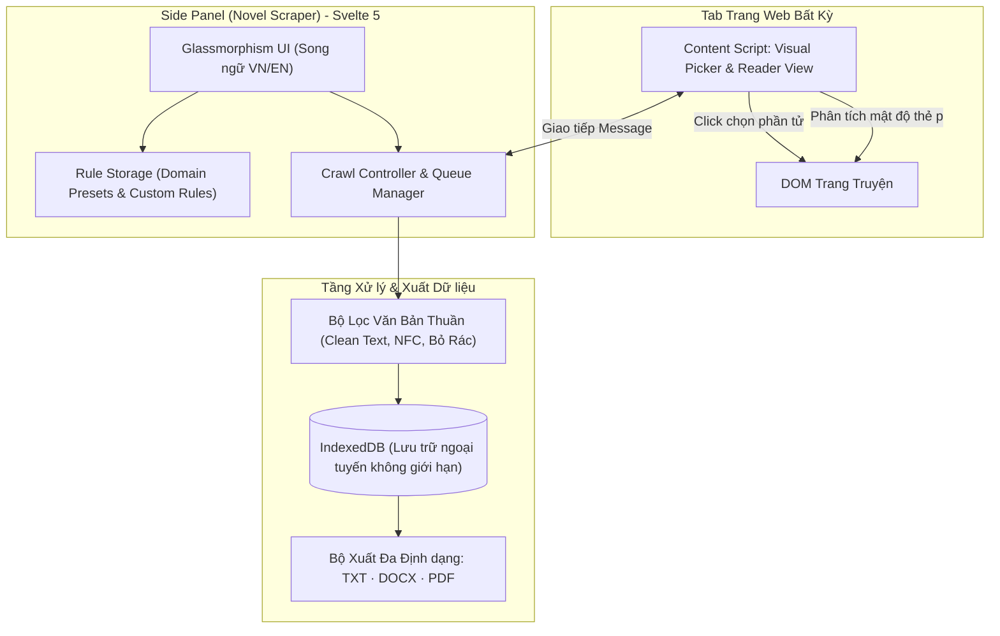

# Kế hoạch Tổng thể & Phương án Kiến trúc: Novel Scraper
*(Tiện ích mở rộng Side Panel cho Chrome · Edge · Firefox — Bản hoàn thiện theo phê duyệt của bạn)*

> [!IMPORTANT]
> **Trạng thái**: Tài liệu thiết kế kỹ thuật và lộ trình triển khai chi tiết. **Chưa bắt đầu viết mã nguồn** (tuân thủ nghiêm ngặt chỉ thị: chỉ lên kế hoạch).

---

## 1. Phân tích Chuyên sâu: Tại sao Dùng Bộ Công cụ (WXT + TypeScript + Svelte 5) Tốt hơn Vượt trội so với Viết Thuần?

Để bạn có cơ sở vững chắc duyệt quyết định kỹ thuật, dưới đây là bảng so sánh thực tế giữa **Bộ công cụ đề xuất** và **Viết chay thuần (Vanilla HTML/CSS/JS)** đối với bài toán cụ thể của **Novel Scraper**:

| Tiêu chí | Viết thuần (HTML/CSS/JS + Tự build) | Bộ công cụ (WXT + TypeScript + Svelte 5) | Đánh giá & Tác động đến Novel Scraper |
|---|---|---|---|
| **Đa trình duyệt (Chrome, Edge, Firefox)** | Phải tự viết script build để nhân bản 3 file `manifest.json`, tự xử lý khác biệt giữa `chrome.sidePanel` (Chromium) và `browser.sidebarAction` (Firefox). Rất dễ nhầm lẫn. | **WXT tự động chuẩn hóa 100%**: 1 lệnh `wxt build -b chrome/firefox/edge` tự tạo gói chuẩn cho từng Store, tự tạo file `sources.zip` bắt buộc của Firefox AMO. | 🟢 **Bộ công cụ vượt trội**: Tiết kiệm hàng chục giờ sửa lỗi tương thích manifest. |
| **Giao diện Glassmorphism & State phức tạp** | Quản lý DOM thủ công (`innerHTML`, `querySelector`). Khi danh sách truyện lên tới 500–2.000 chương, việc cập nhật tiến trình (vòng quay %, dải màu trạng thái, nút Pause/Resume) bằng JS thuần rất dễ gây rò rỉ bộ nhớ (memory leak), giật lag và lỗi lệch dữ liệu. | **Svelte 5 (Runes reactivity)**: Không dùng Virtual DOM nặng như React, biên dịch thẳng ra JS siêu nhẹ (chỉ tốn thêm ~15KB). Giao diện phản hồi tức thì 60 FPS, quản lý danh sách chương mượt mà không tốn RAM. | 🟢 **Bộ công cụ vượt trội**: Đảm bảo hiệu ứng kính mờ (blur) và thanh tiến trình chạy mượt mà ngay cả trên máy yếu. |
| **Độ ổn định & Bắt lỗi cào dữ liệu** | JS thuần không kiểm tra kiểu dữ liệu lúc viết code. Nếu cào đến chương 300 mà gặp cấu trúc web hơi lạ, lỗi `TypeError: undefined is not a function` sẽ làm crash toàn bộ tiến trình cào dở. | **TypeScript**: Bắt buộc định nghĩa rõ cấu trúc dữ liệu (`Novel`, `Chapter`, `CrawlQueue`, `SiteRule`). Mọi sai sót về kiểu dữ liệu đều bị chặn ngay lúc lập trình. | 🟢 **Bộ công cụ vượt trội**: Ngăn chặn tình trạng cào dở hàng nghìn chương bị hỏng giữa chừng. |
| **Môi trường phát triển (DX)** | Mỗi lần sửa 1 dòng CSS kính mờ hay sửa logic cào, bạn phải vào `chrome://extensions` bấm nút Reload thủ công rồi mở lại Side Panel. Rất tốn thời gian. | **Hot Module Reloading (HMR)**: Side Panel tự cập nhật tức thì (live-reload) khi lưu file, giữ nguyên trạng thái đang thử nghiệm. | 🟢 **Bộ công cụ vượt trội**: Tăng tốc độ hoàn thiện giao diện gấp 3 lần. |
| **Tuân thủ chính sách Store** | Viết thuần nếu import thư viện ngoài bằng CDN sẽ bị Google/Mozilla từ chối ngay. | WXT bundle 100% code nội bộ thành các file `.js` tĩnh đóng gói kín, không có remote code, đạt chuẩn bảo mật cao nhất của Chrome Web Store và Firefox AMO. | 🟢 **Cả hai đều tuân thủ tốt**, nhưng WXT hỗ trợ sẵn quy trình kiểm tra `web-ext lint`. |

> [!TIP]
> **Kết luận**: Dùng **WXT + TypeScript + Svelte 5** mang lại sản phẩm chạy mượt mà hơn, mã nguồn sạch sẽ, không bị đơ giật khi cào truyện dài, và tự động hóa toàn bộ khâu xuất file cho cả 3 trình duyệt.

---

## 2. Nâng cấp Yêu cầu & Quyết định từ Người dùng

1. **Phạm vi Toàn diện (Universal Scraper ngay từ MVP)**:
   - Không giới hạn riêng trang Cổ Mộng (`comong.info`).
   - Ngay từ bản đầu tiên, extension tích hợp **bộ trích xuất phổ quát (Generic Engine)** hoạt động trên mọi website đọc truyện:
     - *Tự động bóc tách (Heuristic Reader View)*: Nhận diện nội dung chính dựa trên mật độ văn bản `<p>` và độ dài khối bài viết.
     - *Bộ chọn vùng trực quan (Visual Element Picker)*: Người dùng có thể click chuột vào khung nội dung và tiêu đề chương trên bất kỳ trang lạ nào, extension tự ghi nhớ luật (Rule) cho domain đó.
     - *Tự dò link chương kế tiếp (Smart Next-Chapter Link Finder)*: Tìm nút "Chương sau / Next" bằng từ khóa và thuộc tính `rel="next"`.
2. **Định dạng Xuất**:
   - Loại bỏ EPUB.
   - Hỗ trợ 3 định dạng thiết thực nhất:
     - **TXT** (Mặc định): Chuẩn mã hóa UTF-8 có BOM (`\uFEFF`), mở Notepad/Word trên Windows không bao giờ lỗi font, có vạch ngăn cách chương trang nhã.
     - **DOCX (Microsoft Word)**: Tạo file `.docx` chuyên nghiệp với Heading 1 (Tên truyện), Heading 2 (Tiêu đề chương), ngắt trang (`Page Break`) giữa các chương, căn lề và định dạng phông chữ chuẩn.
     - **PDF**: Chuyển đổi và xuất file PDF sách hoàn chỉnh với mục lục, số trang và lề in chuẩn (Print-ready layout).
3. **Song ngữ Hoàn chỉnh (Vietnamese & English)**:
   - Toàn bộ giao diện Side Panel có nút chuyển đổi tức thì **Tiếng Việt 🇻🇳 / English 🇬🇧** (hỗ trợ tự nhận diện ngôn ngữ trình duyệt qua `chrome.i18n`).
   - Tệp khai báo `manifest.json` quốc tế hóa.
   - Hai bộ tài liệu mô tả, từ khóa và hướng dẫn sử dụng riêng biệt cho 3 Store (Chrome Web Store, Edge Addons, Firefox AMO).
4. **Tên chính thức & Thư mục Dự án**:
   - Tên sản phẩm: **Novel Scraper**
   - Thư mục dự án: `d:\Project\Novel Scraper` (đã được tạo thành công trên hệ thống).

---

## 3. Kiến trúc Kỹ thuật Hoàn thiện (Universal Architecture)



### 3.1. Cơ chế Bóc tách Toàn diện (3-Tier Universal Engine)
* **Tầng 1 - Cấu hình Sẵn (Presets)**: Bộ chọn tối ưu sẵn cho các website phổ biến nhất (Cổ Mộng `comong.info`, TruyệnFull, TangThuvien, MeTruyenChu,...).
* **Tầng 2 - Heuristic Readability**: Với các website bất kỳ không có cấu hình sẵn, thuật toán tự động quét cây DOM để tìm vùng chứa lượng chữ lớn nhất và nhiều thẻ `<p>` nhất (cơ chế tương tự Reader View của Safari/Firefox).
* **Tầng 3 - Visual Picker (Chọn bằng chuột)**: Bấm nút "Chọn vùng cào", di chuột lên trang web (vùng chọn sẽ phát sáng viền xanh neon), click vào khung nội dung và tiêu đề. Extension tự tạo CSS selector và lưu vào bộ nhớ cho toàn bộ các chương cùng trang.

### 3.2. Bộ Xuất File Đa Dạng (TXT, DOCX, PDF)
* **TXT**: Stream trực tiếp từ IndexedDB thành file văn bản thuần cực nhẹ.
* **DOCX**: Đóng gói cấu trúc OpenXML sạch sẽ ngay trên trình duyệt (client-side), thiết lập sẵn phông chữ, ngắt trang giữa các chương, tạo mục lục cấp 1 và cấp 2.
* **PDF**: Áp dụng template in ấn tiêu chuẩn sách văn học, tự động đánh số trang, thụt đầu dòng đoạn văn, hỗ trợ xem trước và tải về trực tiếp.

---

## 4. Hệ thống Thiết kế UI/UX Song ngữ & Glassmorphism 2.0 (Modern Redesign V2)

> [!NOTE]
> Bản thiết kế giao diện thế hệ 2 giải quyết triệt để các nhược điểm của giao diện cũ: loại bỏ các khối đen phẳng cồng kềnh, giảm tải nhận thức (bỏ 3 nút bấm to gây hoang mang), xóa bỏ ký tự chấm đạn thừa (`• Chương 1`), và tối ưu hóa hoàn hảo cho khung Side Panel hẹp (360px – 420px) của Edge, Chrome và Firefox.

### 4.1. Wireframe Trực quan Khung Side Panel Thế hệ Mới (V2 Layout)

```
┌──────────────────────────────────────────────────────────────┐
│  📖 Novel Scraper [PRO]              [ 🔄 ] [ 🇻🇳 VN ] [ 🌙 ] │  <-- Thanh tiêu đề tinh gọn
├──────────────────────────────────────────────────────────────┤
│  [ ⚡ Cào truyện ] [ 📚 Thư viện ] [ 👓 Đọc sách ] [ ⚙️ Cài đặt ] │  <-- Segmented Slider mượt mà
├──────────────────────────────────────────────────────────────┤
│ ┌─ THẺ BÌA TRUYỆN ĐỘNG (HERO NOVEL CARD) ──────────────────┐ │
│ │ 🟢 comong.info · Preset Cổ Mộng        [ Sẵn sàng: 11/11 ]│ │
│ │ ┌─────┐ Người Tôi Thầm Thích Năm Năm, Hóa Ra Chỉ...     │ │
│ │ │BÌA  │ [Ngôn tình] · [15.4k chữ] · [~35 phút đọc]       │ │
│ │ └─────┘                                                  │ │
│ │ Tiến độ lưu trữ: ━━━━━━━━━━━━━━━━━━━━━━ 11/11 (100%)     │ │
│ │ ┌───────────────────────────────┐ ┌────────────────────┐ │ │
│ │ │ ⚡ TẢI NHANH TOÀN BỘ (Primary) │ │ 🎯 Chọn vùng     │ │ │
│ │ └───────────────────────────────┘ └────────────────────┘ │ │
│ └──────────────────────────────────────────────────────────┘ │
├──────────────────────────────────────────────────────────────┤
│ MỤC LỤC CHƯƠNG (11)                      [ Tất cả | Làm trống ]│
│ ┌──────────────────────────────────────────────┐ ┌─────────┐ │
│ │ 🔍 Tìm kiếm chương theo số hoặc tên...       │ │ 🔢 Dải   │ │  <-- Bộ lọc nhanh + Drawer dải
│ └──────────────────────────────────────────────┘ └─────────┘ │
│ ┌──────────────────────────────────────────────────────────┐ │
│ │ [✓] Chương 1: Phản ứng đầu tiên của tôi...   1,406 w 🟢 │ │
│ │ [✓] Chương 2: Cuộc gặp gỡ bất ngờ ở tiệc...   1,404 w 🟢 │ │
│ │ [✓] Chương 3: 【ĐỒNG Ý】hay【TỪ CHỐI】...     1,405 w 🟢 │ │  <-- Giữ chuẩn ngoặc CJK & dấu
│ │ [✓] Chương 4: Sự thật sau lời nói dối 5 năm    903 w 🟢 │ │
│ │ [✓] Chương 5 đến 11: Hồi kết và vạch trần    8,582 w 🟢 │ │
│ └──────────────────────────────────────────────────────────┘ │
├──────────────────────────────────────────────────────────────┤
│ ┌─ FLOATING EXPORT DOCK (CỐ ĐỊNH DƯỚI ĐÁY) ────────────────┐ │
│ │ Định dạng:  [ 📄 TXT ]   [ 📘 DOCX (Word) ]   [ 📕 PDF ]  │ │  <-- Định dạng màu trực quan
│ │ ┌──────────────────────────────────────────────────────┐ │ │
│ │ │ 📥 GỘP & TẢI VỀ (DOCX) — Khắc phục triệt để lỗi font │ │ │
│ │ └──────────────────────────────────────────────────────┘ │ │
│ └──────────────────────────────────────────────────────────┘ │
└──────────────────────────────────────────────────────────────┘
```

### 4.2. 4 Trụ Cột Nâng Cấp Giao Diện & Trải Nghiệm Người Dùng (V2 Pillars)

1. **Thẻ Bìa Truyện Động (Hero Book Card)**:
   - Thay thế khung chữ nhật đen đơn điệu bằng thẻ nổi kính mờ (`backdrop-filter: blur(20px)`).
   - Tích hợp biểu tượng gáy sách chuyển sắc (*Dynamic Book Cover Spine*) với số lượng chương nổi bật.
   - Hiển thị đầy đủ thông số hữu ích: Nguồn website đã xác minh (Preset/Generic), tổng số từ, thời gian đọc ước tính, và thanh tiến trình gradient phát sáng mềm mại (`Electric Cyan` $\rightarrow$ `Azure Indigo`).
2. **Tối Giản Hóa Nhận Thức (Single Hero Action - Không Gây Bối Rối)**:
   - Loại bỏ tình trạng đặt 3 nút bấm kích thước to ngang nhau (*"Pick with Mouse"*, *"Auto Detect"*, *"Scan TOC"*).
   - Thiết lập **1 Nút Hành Động Trọng Tâm (Primary Call-to-Action)** duy nhất: **"⚡ Tải nhanh toàn bộ"** (hoặc *"Quét & Tải"*). Các thao tác chọn vùng thủ công (*Visual Picker*) hay làm mới (*Sync*) được thu gọn thành các nút phụ trực quan xung quanh.
3. **Mục Lục Chương Dạng Thẻ Trực Quan (Streamlined Chapter Index)**:
   - Khắc phục hoàn toàn lỗi lặp ký tự chấm đạn khó nhìn (`• Chương 1`).
   - Mỗi chương được trình bày dưới dạng thẻ bo góc mềm mại, hiển thị rõ số từ, tích hợp trạng thái tải trực quan (xanh lá = đã lưu ngoại tuyến, xanh dương xoay = đang cào, hổ phách = chương khóa/VIP).
   - Tích hợp ô tìm kiếm chương tức thì và hộp thoại chọn dải chương (*Range Drawer*) thu phóng gọn gàng.
4. **Dock Xuất File Phong Cách macOS / Fluent Dock**:
   - Thanh xuất file được gắn cố định tại đáy Side Panel, tách biệt hoàn toàn khỏi danh sách cuộn nội dung.
   - Thẻ định dạng có màu sắc đặc trưng nhận diện nhanh:
     - 📘 **DOCX**: Xanh dương Microsoft Word (áp dụng chuẩn `Microsoft YaHei` cho ngoặc CJK, chống lỗi font `Ụ ĐỒNG Ýụ`).
     - 📕 **PDF**: Đỏ Acrobat Print-ready.
     - 📄 **TXT**: Xám đá thanh lịch chuẩn UTF-8 BOM.
   - Nút **"Gộp & Tải về"** to bản, chuyển động phản hồi mượt mà kèm trạng thái xoay loading khi đang đóng gói tệp.

### 4.3. Hệ Thống Token Thiết Kế (Design Tokens & Color Palette)

| Token | Mã Màu Dark Theme | Mã Màu Light Theme | Ý nghĩa & Vị trí Áp dụng |
|---|---|---|---|
| `--bg-base` | `#070B14` (Midnight Deep) | `#F8FAFC` (Slate Snow) | Nền gốc toàn bộ Side Panel |
| `--surface-glass` | `rgba(15, 23, 42, 0.72)` | `rgba(255, 255, 255, 0.85)` | Thẻ kính mờ chính, thanh Dock |
| `--border-subtle` | `rgba(255, 255, 255, 0.08)` | `rgba(226, 232, 240, 0.8)` | Đường viền phân cách siêu mảnh |
| `--accent-cyan` | `#38BDF8` (Electric Sky) | `#0284C7` (Sky Blue) | Điểm nhấn chính, tiến trình, CTA |
| `--accent-indigo` | `#6366F1` (Azure Indigo) | `#4F46E5` (Deep Indigo) | Gradient phụ, tab hoạt động |
| `--accent-success` | `#34D399` (Emerald) | `#059669` (Green Emerald) | Trạng thái hoàn thành, nút Tải về |
| `--accent-warning` | `#FBBF24` (Amber) | `#D97706` (Amber Gold) | Cảnh báo thiếu chương / Chương VIP |
| `--font-primary` | `'Plus Jakarta Sans', system-ui` | Cùng bộ phông | Phông chữ giao diện chính |
| `--font-reader` | `'Merriweather', Georgia, serif` | Cùng bộ phông | Phông chữ đọc truyện ngoại tuyến |

> [!TIP]
> **Nguyên mẫu Tương tác Đính kèm**: Toàn bộ giao diện thế hệ mới đã được đóng gói thành nguyên mẫu tương tác hoàn chỉnh tại file [`novel_scraper_modern_ui.html`](file:///C:/Users/lmt%20pc/.gemini/antigravity/brain/7a104538-0052-44ae-a260-1ff90a7f88c6/novel_scraper_modern_ui.html) trong thư mục Artifact. Bạn có thể mở trực tiếp để click thử nghiệm các hiệu ứng chuyển đổi tab, đổi giao diện Sáng/Tối, và bật/tắt song ngữ VN/EN.

---

## 5. Lộ trình Triển khai 8 Giai đoạn Hoàn chỉnh

```mermaid
flowchart LR
    G1["GĐ 1<br/>Khung WXT & Đa nền tảng"] --> G2["GĐ 2<br/>Generic Engine & Sanitizer"]
    G2 --> G3["GĐ 3<br/>Visual Picker & Rule System"]
    G3 --> G4["GĐ 4<br/>Cào Tự động & Hàng đợi"]
    G4 --> G5["GĐ 5<br/>Bộ Xuất: TXT, DOCX, PDF"]
    G5 --> M1{{"🎯 CỘT MỐC MVP"}}
    M1 --> G6["GĐ 6<br/>UI Glassmorphism & Song ngữ"]
    G6 --> G7["GĐ 7<br/>Kiểm thử & Tối ưu Toàn diện"]
    G7 --> G8["GĐ 8<br/>Branding & Đóng gói Store"]
```



### 🔹 Giai đoạn 1: Khởi tạo Bộ khung Đa nền tảng (Foundation)
1. Khởi tạo dự án trong thư mục `d:\Project\Novel Scraper` với **WXT + TypeScript + Svelte 5**.
2. Thiết lập cấu hình đa mục tiêu:
   - Chromium MV3 (`side_panel`) cho Chrome và Edge.
   - Firefox MV3 (`sidebar_action`, `browser_specific_settings.gecko.id`, `data_collection_permissions: none`).
3. Cài đặt hệ thống dịch i18n (`_locales/vi` và `_locales/en`).
4. Khởi tạo sơ đồ cơ sở dữ liệu IndexedDB (`novels`, `chapters`, `crawl_queue`, `site_rules`).

### 🔹 Giai đoạn 2: Bộ Bóc Tách Phổ Quát & Lọc Văn Bản Thuần (Generic Extractor & Sanitizer)
1. Xây dựng thuật toán **Heuristic Reader View**: Tự động bóc tách tiêu đề chương và nội dung chính trên bất kỳ trang web nào dựa vào cấu trúc DOM.
2. Xây dựng **Pure Text Sanitizer Pipeline**:
   - Loại bỏ 100% hình ảnh, video, iframe, link ngoài, script.
   - Chuẩn hóa Unicode tiếng Việt (NFC).
   - Loại bỏ ký tự vô hình rác (`\u200B–\u200D`, `\uFEFF`).
   - Bộ lọc từ khóa quảng cáo/watermark mặc định + cho phép người dùng tự thêm từ khóa lọc.

### 🔹 Giai đoạn 3: Bộ Chọn Phần Tử Trực Quan & Quản lý Luật Trang (Visual Element Picker & Rules)
1. Tính năng **Visual Element Picker**: Cho phép click chuột vào phần tử bất kỳ trên trang để lấy selector cho: Khung nội dung, Tiêu đề chương, Nút chương kế tiếp.
2. Hệ thống lưu trữ và quản lý Rule: Tự động ghi nhớ cấu hình riêng theo tên miền website, có tính năng Xuất/Nhập file cấu hình JSON.

### 🔹 Giai đoạn 4: Động cơ Cào Tự động Bền vững (Batch Crawler & Queue)
1. Cơ chế quét mục lục tự động (hỗ trợ phân trang và danh sách chương tải bằng AJAX).
2. Hàng đợi cào bền vững lưu trong IndexedDB: Tự động phục hồi trạng thái sau khi đóng trình duyệt hoặc tắt máy.
3. Cơ chế **Tải lịch sự (Polite Crawling)**: Chèn độ trễ ngẫu nhiên (Adaptive Jitter 1.5s - 3s), tự động chờ khi gặp lỗi quá tải server (`429/503`).
4. Xử lý tương tác Captcha và tự động bỏ qua/đánh dấu chương bị khóa bản quyền (VIP).

### 🔹 Giai đoạn 5: Bộ Công cụ Gộp & Xuất Đa Định Dạng (TXT · DOCX · PDF) -> 🎯 CỘT MỐC MVP
1. **Thuật toán Gộp thông minh**: Sắp xếp thứ tự tự nhiên (Natural Sort), khử trùng lặp chương, kiểm tra thiếu chương theo từng quyển và cho phép bấm 1 nút để tải bù.
2. **Xuất file TXT**: Chuẩn UTF-8 BOM, ngắt đoạn rõ ràng, không lỗi font.
3. **Xuất file DOCX**: Định dạng văn bản Word chuẩn có phân cấp tiêu đề, mục lục và ngắt trang.
4. **Xuất file PDF**: Tạo file PDF đóng gáy sách có đánh số trang và canh lề đẹp mắt.
5. **Kiểm thử nghiệm thu MVP**: Hoàn thành một luồng trọn vẹn từ cào nhiều trang web khác nhau đến xuất đủ 3 định dạng file.

### 🔹 Giai đoạn 6: Triển khai Giao diện Hiện đại Fluent Glassmorphism 2.0 & Song ngữ
1. **Nâng cấp Hệ thống Giao diện (`theme.css`)**:
   - Áp dụng các biến màu CSS Tokens mới (Midnight Deep `#070B14`, Electric Sky `#38BDF8`, Azure Indigo `#6366F1`, Emerald `#34D399`).
   - Tối ưu hóa lớp kính mờ mỏng nhẹ (`backdrop-filter: blur(20px)`), hiệu ứng quầng sáng chuyển động mềm mại (*ambient glow*) không làm nóng GPU.
   - Hoàn thiện chế độ **Dark Mode** & **Light Mode** đạt chuẩn tương phản cao WCAG AA.
2. **Tái cấu trúc Khung Điều hướng & Header (`Header.svelte` & `Tabs.svelte`)**:
   - Header thu gọn tối đa độ cao: Hiển thị logo, trạng thái phiên bản, nút làm mới đồng bộ tab (🔄), nút chuyển ngôn ngữ tức thì (🇻🇳/🇬🇧) và nút đổi chủ đề (🌙/☀️).
   - Thanh Tab chuyển đổi thành dạng trượt phân đoạn mượt mà (*Smooth Segmented Slider*), có hiệu ứng chuyển trạng thái linh hoạt cho 4 tab: *Cào truyện*, *Thư viện*, *Đọc sách*, *Cài đặt*.
3. **Hiện đại hóa Tab Cào Truyện (`ScraperTab.svelte`)**:
   - Tích hợp **Hero Novel Card**: Bìa sách gáy màu gradient, chip nguồn domain (`comong.info`), thống kê số chữ, thời lượng đọc dự tính và thanh tiến trình gradient sống động.
   - Tập trung nút hành động: **"⚡ Tải nhanh toàn bộ"** là nút CTA chính duy nhất nổi bật, nút *Chọn vùng* và *Làm mới* thu gọn bên cạnh.
   - Danh sách chương: Xóa bỏ hoàn toàn lỗi lặp dấu chấm đạn (`• Chương 1`), chuyển sang thẻ card bo góc nhẹ, thêm thanh tìm kiếm chương và bộ chọn dải chương (*Range Drawer*).
4. **Dock Xuất File Phong Cách macOS (`Floating Export Dock`)**:
   - Gắn cố định dưới chân Side Panel: Thẻ định dạng có màu sắc đặc trưng (DOCX xanh, PDF đỏ, TXT xám), nút bấm Gộp & Tải to bản kèm spinner phản hồi khi đóng gói.
5. **Tích hợp Tab Đọc Ngoại Tuyến (`OfflineReader.svelte`)**:
   - Tùy chỉnh cỡ chữ, phông serif cổ điển (`Merriweather`), chế độ đọc ban đêm không mỏi mắt trực tiếp ngay trong Side Panel.

### 🔹 Giai đoạn 7: Kiểm thử Chuyên sâu & Tối ưu Hiệu năng (QA & Polish)
1. Kiểm thử cào thực tế trên 5 website truyện khác nhau (bao gồm `comong.info`, trang có phân trang mục lục, và trang có anti-copy).
2. Kiểm thử sức chịu tải với bộ truyện dài trên 1.500 chương (kiểm soát bộ nhớ RAM và tốc độ ghi file).
3. Chạy công cụ kiểm tra bảo mật `web-ext lint` cho Firefox và audit bảo mật Manifest V3 cho Chromium.

### 🔹 Giai đoạn 8: Thiết kế Nhận diện Thương hiệu & Đóng gói Nộp Store (Branding & Submission)
1. **Thiết kế Logo Vector (SVG)**:
   - Biểu tượng cuốn sách thủy tinh cách điệu độc quyền (không dùng biểu tượng hay logo của các hãng trình duyệt).
   - 3 biến thể màu sắc hài hòa: Chrome (Electric/Azure), Edge (Fluent Sapphire), Firefox (Midnight/Electric).
   - Xuất icon đầy đủ kích thước: 16, 32, 48, 128, 300, 512px.
2. **Thiết kế Ảnh Quảng bá (Store Assets)**:
   - Chrome Web Store: Promo Tile 440x280, Banner 1400x560, Screenshots 1280x800.
   - Edge Add-ons: Logo 300x300, Hero Tile 1280x720, Screenshots 1280x800.
   - Firefox AMO: Icon và Screenshots tỷ lệ 1.6:1.
   - Làm đủ 2 phiên bản ảnh chụp màn hình: Tiếng Việt và Tiếng Anh.
3. **Đóng gói & Tài liệu Xét duyệt**:
   - Lệnh đóng gói tự động xuất 3 file ZIP: `novel-scraper-chrome.zip`, `novel-scraper-edge.zip`, `novel-scraper-firefox.zip`, kèm `sources.zip` cho AMO.
   - Soạn thảo Privacy Policy và Reviewer Notes giải thích quyền rõ ràng, sẵn sàng để nộp lên cả 3 chợ tiện ích.
