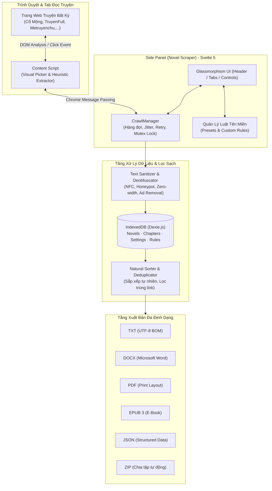

# 📖 Novel Scraper — Universal Web Novel Downloader & Offline Reader

[-10B981?style=for-the-badge&logo=vitest)](test/)
[](wxt.config.ts)
[](wxt.config.ts)
[](entrypoints/sidepanel/)
[](tsconfig.json)

**Novel Scraper** là tiện ích mở rộng Side Panel thế hệ mới, hoạt động trên các trình duyệt Chromium (Chrome, Edge, Brave, Cốc Cốc) và Mozilla Firefox. Tiện ích cung cấp giải pháp toàn diện để nhận diện, cào tự động, làm sạch văn bản, lưu trữ ngoại tuyến và xuất sách tiểu thuyết mạng từ **bất kỳ trang web nào** sang các định dạng chuẩn (TXT UTF-8 BOM, DOCX Microsoft Word, PDF in ấn, EPUB 3 sách điện tử, JSON dữ liệu).

Dự án được xây dựng với phương châm **100% Client-Side**, không có máy chủ trung gian, không thu thập dữ liệu (telemetry-free), giao diện Deep Blue Glassmorphism sang trọng và chuyển đổi song ngữ tức thì Việt - Anh.

---

## 📑 Mục Lục

1. [Tổng Quan Kiến Trúc & Công Nghệ](#-tổng-quan-kiến-trúc--công-nghệ)
2. [Tính Năng Nổi Bật](#-tính-năng-nổi-bật)
   - [Engine Bóc Tách 3 Tầng (Universal 3-Tier Engine)](#1-engine-bóc-tách-3-tầng-universal-3-tier-engine)
   - [Trình Cào Lịch Sự & Bền Bỉ (Polite Crawler)](#2-trình-cào-lịch-sự--bền-bỉ-polite--resilient-crawler)
   - [Bộ Lọc Văn Bản Siêu Sạch (Text Sanitizer & Deobfuscator)](#3-bộ-lọc-văn-bản-siêu-sạch-sanitizer-pipeline)
   - [Xuất Đa Định Dạng & Đặt Tên Tự Động](#4-xuất-đa-định-dạng--đặt-tên-file-tự-động)
   - [Thư Viện Ngoại Tuyến & Trình Đọc Sách Tích Hợp](#5-thư-viện-ngoại-tuyến--trình-đọc-sách-tích-hợp-offline-reader)
   - [Giao Diện Kính Mờ & Song Ngữ](#6-giao-diện-kính-mờ-glassmorphism--song-ngữ)
3. [Sơ Đồ Luồng Hoạt Động (Architecture Flowchart)](#-sơ-đồ-luồng-hoạt-động)
4. [Cấu Trúc Thư Mục Dự Án](#-cấu-trúc-thư-mục-dự-án)
5. [Hướng Dẫn Cài Đặt & Phát Triển](#-hướng-dẫn-cài-đặt--phát-triển)
   - [Yêu Cầu Hệ Thống](#yêu-cầu-hệ-thống)
   - [Cài Đặt Thư Viện](#cài-đặt-thư-viện)
   - [Chạy Môi Trường Phát Triển (Dev / HMR)](#chạy-môi-trường-phát-triển-dev--hmr)
   - [Kiểm Thử Tự Động (Vitest Test Suite)](#kiểm-thử-tự-động-vitest-test-suite)
   - [Kiểm Tra Kiểu Dữ Liệu (TypeScript Check)](#kiểm-tra-kiểu-dữ-liệu-typescript-check)
   - [Đóng Gói Bản Cài Đặt (Production Build & Store Packages)](#đóng-gói-bản-cài-đặt-production-build--store-packages)
6. [Hướng Dẫn Tải Tiện Ích Vào Trình Duyệt](#-hướng-dẫn-tải-tiện-ích-vào-trình-duyệt)
7. [Chính Sách Bảo Mật & Quyền Riêng Tư](#-chính-sách-bảo-mật--quyền-riêng-tư)
8. [Giấy Phép](#-giấy-phép)

---

## 🚀 Tổng Quan Kiến Trúc & Công Nghệ

Novel Scraper áp dụng mô hình kiến trúc module phân lớp rõ ràng, đảm bảo hiệu năng cao, không gây rò rỉ bộ nhớ ngay cả khi xử lý các bộ tiểu thuyết dài hàng nghìn chương:

| Thành phần | Công nghệ / Thư viện | Vai trò kỹ thuật |
|---|---|---|
| **Extension Framework** | [WXT 0.21+](https://wxt.dev/) | Xây dựng tiện ích Manifest V3 thế hệ mới trên nền tảng Vite, tự động tối ưu cho Chrome (`side_panel`) và Firefox (`sidebar_action`). |
| **Giao Diện (UI Layer)** | [Svelte 5 (Runes Reactivity)](https://svelte.dev/) | Phản hồi giao diện cực nhạy (60 FPS), không dùng Virtual DOM, dung lượng biên dịch siêu nhỏ (~15KB), không chiếm dụng RAM khi cào truyện dài. |
| **Ngôn Ngữ & Type-Safety** | [TypeScript 5.7+](https://www.typescriptlang.org/) | Strict type checking đảm bảo độ tin cậy tuyệt đối, loại trừ toàn bộ lỗi `null/undefined` runtime. |
| **Cơ Sở Dữ Liệu Nội Bộ** | [Dexie.js 4+ (IndexedDB)](https://dexie.org/) | Lưu trữ truyện, chương, hàng đợi cào và quy tắc tên miền ngoại tuyến không giới hạn dung lượng lưu trữ cục bộ. |
| **Bộ Xuất Văn Bản** | `docx`, `jspdf`, Custom Zip | Sinh trực tiếp file Word `.docx`, PDF in ấn, EPUB 3 và tệp `.zip` chia tập mà không cần thư viện máy chủ. |
| **Hệ Thống Kiểm Thử** | [Vitest 3+](https://vitest.dev/) + `happy-dom` | 37 bộ kiểm thử với **439 bài test tự động** bao phủ từ đơn vị, tích hợp, stress test đến tấn công biên (adversarial test). |

---

## 🌟 Tính Năng Nổi Bật

### 1. Engine Bóc Tách 3 Tầng (Universal 3-Tier Engine)
Extension giải quyết triệt để bài toán thay đổi giao diện web truyện với cơ chế bóc tách thông minh:
* **Tầng 1 — Cấu Hình Sẵn (Presets)**: Bộ chọn CSS tối ưu riêng cho các trang web lớn tại Việt Nam:
  * **Cổ Mộng** (`comong.info`): Bóc tách chuẩn xác nội dung, loại bỏ nút "Xem thêm" `.w2w_read_more`, bắt link chương kế dạng mũi tên (`→`).
  * **TruyệnFull** (`truyenfull.vn`, `truyenfull.io`): Tự động nhận diện cấu trúc phân trang chương và khung đọc `#chapter-c`.
  * **Tàng Thư Viện** (`truyen.tangthuvien.vn`): Xử lý mục lục chương nhiều trang, bóc tách tiêu đề chuẩn.
  * **Mê Truyện Chữ** (`metruyenchu.com.vn`, `metruyenchuvn.com`, `metruyencv.com`, `metruyencv.us`): Tự động vượt qua cấu trúc AJAX phân trang 100 chương/trang (`/get/listchap/{id}?page={p}`), nhảy từ trang đọc chương trực tiếp về mục lục gốc không lẫn truyện gợi ý ngoài lề.
* **Tầng 2 — Thuật Toán Heuristic Reader View**: Tự động phân tích cây DOM trên bất kỳ trang web lạ nào; tính toán mật độ thẻ `<p>`, độ dài đoạn văn và tỷ lệ ký tự chữ để định vị chính xác khối bài đọc chính mà không cần cấu hình.
* **Tầng 3 — Bộ Chọn Vùng Bằng Chuột (Visual Element Picker)**:
  * Người dùng bấm nút **Pick with Mouse**, rê chuột lên trang web: phần tử sẽ phát sáng với viền Neon Electric Blue (`#00D2FF`).
  * Click chuột để chọn khung văn bản và tiêu đề. Hệ thống tự tính toán CSS Selector tối ưu nhất và lưu vào cấu hình tên miền để sử dụng vĩnh viễn.

---

### 2. Trình Cào Lịch Sự & Bền Bỉ (Polite & Resilient Crawler)
* **Quét Mục Lục Toàn Trang (Full TOC Scanner)**:
  * Tự động quét toàn bộ danh sách chương từ trang tổng quan hoặc trang đọc chương.
  * Hỗ trợ duyệt qua tất cả các trang phân trang (pagination) và phân trang bất đồng bộ (AJAX multi-page).
  * Lọc sạch các link rác từ khối "Truyện đề cử", "Truyện hot mới" hoặc liên kết chân trang.
* **Tự Động Đồng Bộ Tab Trình Duyệt (Tab Auto-Sync)**:
  * Khi chuyển tab hoặc tải lại trang F5, tiện ích tự nhận diện truyện hiện tại theo URL, slug hoặc tiêu đề.
  * Hỗ trợ nút **Làm mới dữ liệu** (Refresh xoay hiệu ứng) và nút **Làm trống danh sách** để quét lại từ đầu khi danh sách bị nhiễm liên kết lạ.
* **Lịch Sự & Tránh Bị Chặn IP (Polite Crawling & Adaptive Jitter)**:
  * Tự động chèn độ trễ ngẫu nhiên (mặc định 1.5s – 3.0s, có thể tinh chỉnh) giữa các lần tải chương.
  * Tránh kích hoạt hệ thống bảo vệ Cloudflare / WAF hoặc làm quá tải máy chủ nguồn.
* **Cơ Chế Phục Hồi Lỗi & Vượt Rào Cản CORS**:
  * Tự động thử lại (Retry) với độ trễ tăng dần (Exponential Backoff) khi gặp mã lỗi `429 Too Many Requests` hoặc `503 Service Unavailable`.
  * **Tab Delegation Fetch**: Nếu Service Worker bị chặn CORS, extension tự động ủy quyền gửi lệnh fetch qua Content Script của Tab trình duyệt đang mở để tiếp tục cào mượt mà.
* **Phát Hiện & Cào Bù Chương Thiếu (`detectMissingChapters`)**:
  * Tự động phân tích số thứ tự chương, đánh dấu các chương bị gián đoạn hoặc tải lỗi.
  * Cho phép tải lại riêng từng chương lỗi hoặc 1-click cào bù tất cả chỉ trong nháy mắt.

---

### 3. Bộ Lọc Văn Bản Siêu Sạch (Sanitizer Pipeline)
Toàn bộ nội dung văn bản sau khi lấy về đều đi qua chuỗi xử lý làm sạch tiêu chuẩn cao:
* **Chuẩn Hóa Unicode**: Đưa toàn bộ ký tự tiếng Việt về dạng tổ hợp chuẩn **Unicode NFC**.
* **Tẩy Sạch Ký Tự Tàng Hình & Rác Mã Hóa**: Loại bỏ hoàn toàn các ký tự zero-width spaces (`\u200B`–`\u200D`), Byte-Order-Mark rác (`\uFEFF`), soft hyphen (`\u00AD`) và các mã nhúng gián điệp.
* **Triệt Tiêu Bẫy Chống Bot (Honeypot Traps)**: Quét và bóc tách các thẻ ẩn cố tình cài cắm (`style*="display:none"`, `style*="visibility:hidden"`, thuộc tính `hidden`) của các trang web chống cào.
* **Xóa Bỏ Quảng Cáo & Nút UI**: Loại bỏ iframe, video, ảnh rác, khối quảng cáo Google Ads, banner, nút "Xem thêm / Đọc tiếp".
* **Bộ Lọc Watermark & Cụm Từ Re-up**:
  * Tích hợp sẵn danh mục từ khóa lọc các câu thông báo re-up, kêu gọi đọc tại trang chính chủ, tên miền website chèn lén trong nội dung.
  * Người dùng có thể tự do bổ sung các từ khóa hoặc cặp từ thay thế (Find & Replace / Regex) trong phần Cài đặt.
* **Giải Mã Chữ Biến Dạng (Deobfuscator)**: Khôi phục văn bản từ các font chữ bị xáo trộn hoặc bảng mã thay thế do website áp dụng để chống copy.

---

### 4. Xuất Đa Định Dạng & Đặt Tên File Tự Động
* **Tự Động Đặt Tên File Theo Truyện**: File xuất ra luôn lấy tên truyện chuẩn hóa làm tên tệp (`Cao_Vo_Dang_Nhap_Tuong_Lai_Mot_Van_Nam.txt`), tự động loại bỏ các ký tự cấm của hệ điều hành (`\ / : * ? " < > |`).
* **Hỗ Trợ 5 Định Dạng Xuất Chuẩn**:
  1. **TXT (Mặc định)**: Mã hóa **UTF-8 có BOM (`\uFEFF`)**, mở trên Windows Notepad / Wordpad / MS Word đảm bảo 100% không bao giờ bị lỗi font tiếng Việt; trình bày vạch phân cách chương trang nhã.
  2. **DOCX (Microsoft Word)**: Đóng gói định dạng OpenXML tiêu chuẩn, thiết lập Heading 1 cho tên truyện, Heading 2 cho tiêu đề chương, ngắt trang (`PageBreak`) giữa các chương và căn lề đoạn văn hoàn chỉnh.
  3. **PDF (Bản In Sách Văn Học)**: Tạo bố cục sách in thanh lịch, tự động đánh số trang, thụt lề đầu đoạn văn, hỗ trợ xem trước và in trực tiếp ra file PDF.
  4. **EPUB 3 (Sách Điện Tử Quốc Tế)**: Tạo gói tệp `.epub` chuẩn cấu trúc MIME, `content.opf`, `toc.ncx`, trang bìa và file XHTML riêng cho từng chương, tương thích hoàn hảo với máy đọc sách Kindle, Kobo, Apple Books.
  5. **JSON (Cấu Trúc Dữ Liệu Đầy Đủ)**: Xuất toàn bộ siêu dữ liệu (metadata) cùng toàn văn các chương, phục vụ lưu trữ dự phòng hoặc kết nối các công cụ phân tích văn bản.
* **Tách Tập Tự Động & Đóng Gói ZIP**: Cho phép chia nhỏ các bộ truyện dài (vd: tách 100 chương/tập). Tiện ích sẽ đóng gói toàn bộ các tập thành 1 file nén `.zip` tải về trong 1 lần bấm.
* **Tùy Chọn Ẩn Tiêu Đề Chương Lặp Lại (`omitChapterTitles`)**: Tự động loại bỏ dòng tiêu đề chương bị lặp ở đầu nội dung nếu trang gốc đã nhúng sẵn.

---

### 5. Thư Viện Ngoại Tuyến & Trình Đọc Sách Tích Hợp (Offline Reader)
* **Kho Lưu Trữ Truyện Offline**: Mọi truyện và chương đã cào được lưu an toàn trong IndexedDB của trình duyệt. Bạn có thể tắt máy, mở lại bất kỳ lúc nào để đọc tiếp hoặc xuất file mà không cần mạng.
* **Trình Đọc Sách Ngoại Tuyến Đầy Đủ Tiện Nghi**:
  * Tích hợp ngay trên thanh bên Side Panel.
  * Tùy chỉnh kích thước phông chữ tăng giảm linh hoạt.
  * Đổi kiểu phông: Phông Serif (có chân phong cách sách in) hoặc Phông Sans (không chân hiện đại).
  * 3 Chế độ màu sắc: **Dark (Nền tối chống mỏi mắt)**, **Sepia (Vàng cổ điển)**, **Light (Sáng trang nhã)**.
  * Tự động ghi nhớ vị trí chương đang đọc dở của từng bộ truyện.
* **Sao Lưu & Phục Hồi Dữ Liệu (Backup & Restore)**: 1-click xuất toàn bộ thư viện và cấu hình ra file JSON, dễ dàng chuyển dữ liệu giữa các máy tính hoặc giữa Chrome, Edge, Firefox.

---

### 6. Giao Diện Kính Mờ (Glassmorphism) & Song Ngữ
* **Ngôn Ngữ Thiết Kế RonDesignLab Deep Blue**: Hiệu ứng kính mờ frosted glass (`backdrop-filter: blur(20px)`), viền phát sáng Cyan tinh tế, bố cục thẻ (card) gọn gàng, tối ưu tuyệt đối cho khung Side Panel hẹp (360px – 450px).
* **Đầy Đủ Chế Độ Sáng/Tối**: Dark Mode và Light Mode đạt chuẩn tương phản cao **WCAG AA**.
* **Chuyển Đổi Song Ngữ Tức Thì**: Chuyển đổi qua lại giữa **Tiếng Việt 🇻🇳** và **English 🇬🇧** chỉ với 1 click chuột mà không cần tải lại trang.
* **Phím Tắt Toàn Hệ Thống**: Nhấn `Alt + Shift + N` (hoặc phím tùy chỉnh) trên bàn phím để mở nhanh Side Panel bất cứ lúc nào.

---

## 🏗️ Sơ Đồ Luồng Hoạt Động



---

## 📁 Cấu Trúc Thư Mục Dự Án

```
novel-scraper/
├── .output/                      # Thư mục chứa bản build và các gói ZIP nộp Store
│   ├── chrome-mv3/               # Bản build giải nén cho Chrome / Edge
│   ├── edge-mv3/                 # Bản build giải nén tối ưu cho Microsoft Edge
│   ├── firefox-mv3/              # Bản build giải nén cho Firefox
│   ├── novel-scraper-1.0.0-chrome.zip
│   ├── novel-scraper-1.0.0-edge.zip
│   ├── novel-scraper-1.0.0-firefox.zip
│   └── novel-scraper-1.0.0-sources.zip
├── components/                   # Các thành phần giao diện Svelte 5
│   ├── Header.svelte             # Thanh tiêu đề: Logo, Song ngữ, Chế độ Sáng/Tối
│   ├── Tabs.svelte               # Thanh chuyển tab: Cào truyện, Thư viện, Quy tắc, Cài đặt
│   ├── ScraperTab.svelte         # Tab chính: Quét TOC, Picker chuột, Tiến độ cào, Xuất file
│   ├── LibraryTab.svelte         # Quản lý kho truyện offline, xuất định dạng, mở trình đọc
│   ├── OfflineReader.svelte      # Trình đọc truyện ngoại tuyến tích hợp (Font, Cỡ chữ, Theme)
│   ├── RulesTab.svelte           # Trình chỉnh sửa luật bóc tách CSS, Import/Export JSON
│   └── SettingsTab.svelte        # Cấu hình độ trễ Jitter, từ điển watermark, Backup/Restore
├── entrypoints/                  # Các điểm vào mở rộng (WXT Entrypoints)
│   ├── background.ts             # Service worker quản lý vòng đời Side Panel & phím tắt
│   ├── content.ts                # Content script: Highlight phần tử chuột, trích xuất DOM
│   ├── sidepanel.html            # Khung HTML gốc của Side Panel
│   └── sidepanel/
│       ├── App.svelte            # Ứng dụng gốc điều phối trạng thái giao diện
│       ├── main.ts               # Khởi tạo và gắn kết (mount) Svelte 5
│       └── theme.css             # Hệ thống CSS biến màu sắc Glassmorphism
├── lib/                          # Thư viện lõi xử lý logic độc lập
│   ├── crawler/                  # Quản lý hàng đợi cào, phân trang đa tầng, Jitter, Retry
│   ├── db/                       # Khởi tạo Dexie.js và bộ cấu hình mặc định (Presets)
│   ├── exporter/                 # Xử lý xuất file TXT, DOCX, PDF, EPUB, JSON, Sorter, Zip
│   ├── extractor/                # Bóc tách bằng luật CSS, thuật toán Heuristic, Tab Info
│   ├── i18n/                     # Hệ thống dịch thuật song ngữ tức thì (VI / EN)
│   ├── picker/                   # Tạo viền phát sáng neon và thuật toán sinh CSS selector
│   ├── rules/                    # Khớp tên miền, nạp cấu hình và quản lý luật
│   ├── sanitizer/                # Làm sạch HTML, NFC, xóa honeypot, watermark, deobfuscator
│   ├── storage/                  # Lưu trữ cấu hình ứng dụng và sao lưu cơ sở dữ liệu
│   └── types/                    # Định nghĩa giao diện kiểu dữ liệu TypeScript
├── public/                       # Tài nguyên tĩnh
│   ├── _locales/                 # Bản dịch đa ngôn ngữ chuẩn Chrome i18n (vi, en)
│   └── icon/                     # Bộ biểu tượng sách phát sáng (16, 32, 48, 128, 300, 512px)
├── scripts/                      # Kịch bản tự động sinh asset ảnh Store bằng Sharp
├── store-assets/                 # Banner (1400x560), Promo Tile (440x280), Screenshots (1280x800)
├── test/                         # 37 tệp kiểm thử tự động với 439 bài test Vitest
├── NOVEL_SCRAPER_PLAN_V2.md      # Tài liệu đặc tả kỹ thuật và thiết kế gốc
├── PRIVACY_POLICY.md             # Chính sách bảo mật song ngữ chính thức
├── REVIEWER_NOTES.md             # Hướng dẫn kiểm duyệt dành cho nhân viên duyệt Store
├── STORE_LISTINGS.md             # Bộ mô tả và từ khóa tối ưu nộp 3 Store
├── package.json                  # Cấu hình dự án, lệnh scripts và danh sách dependencies
├── tsconfig.json                 # Cấu hình trình biên dịch TypeScript
├── vitest.config.ts              # Cấu hình môi trường kiểm thử Vitest
└── wxt.config.ts                 # Cấu hình đóng gói WXT đa trình duyệt Manifest V3
```

---

## 🛠️ Hướng Dẫn Cài Đặt & Phát Triển

### Yêu Cầu Hệ Thống
* **Node.js**: Phiên bản 20 trở lên (khuyến nghị `v22.x LTS`).
* **npm**: Phiên bản 10 trở lên.
* Trình duyệt: Google Chrome, Microsoft Edge hoặc Mozilla Firefox bản mới nhất.

### Cài Đặt Thư Viện
Mở terminal tại thư mục dự án và chạy:
```bash
npm install
```

### Chạy Môi Trường Phát Triển (Dev / HMR)
Khởi chạy tiện ích với tính năng tự động tải lại (Hot Module Reloading):
```bash
# Dành cho Chrome / Edge (Chromium MV3)
npm run dev

# Dành cho Mozilla Firefox (MV3)
npm run dev:firefox
```
Trình duyệt sẽ tự động khởi động cùng tiện ích đã được nạp sẵn. Khi bạn chỉnh sửa mã nguồn Svelte hoặc TypeScript, giao diện Side Panel sẽ tự cập nhật tức thì.

### Kiểm Thử Tự Động (Vitest Test Suite)
Dự án sở hữu bộ kiểm thử tự động toàn diện bậc nhất với **439 bài kiểm thử** trải dài trên **37 bộ kiểm tra** (kiểm thử bóc tách, tải trang giả lập, sắp xếp 5.000 chương, khử trùng văn bản, bảo vệ chống ReDoS):
```bash
# Chạy bộ test trên Windows / Linux / macOS
npm test
# Hoặc trên Windows PowerShell nếu có phân quyền script:
npm.cmd test
```
*Kết quả: 37/37 test files passed, 439/439 tests passed (thời gian thực thi ~19 giây).*

### Kiểm Tra Kiểu Dữ Liệu (TypeScript Check)
Đảm bảo 100% mã nguồn không phát sinh bất kỳ lỗi kiểu dữ liệu nào:
```bash
npm run check
# Hoặc:
npm.cmd run check
```

### Đóng Gói Bản Cài Đặt (Production Build & Store Packages)
```bash
# 1. Biên dịch mã nguồn cho từng trình duyệt
npm run build:chrome
npm run build:edge
npm run build:firefox

# Hoặc biên dịch tất cả cùng một lệnh:
npm run build:all

# 2. Đóng gói các tệp .ZIP sẵn sàng nộp lên Chrome Web Store, Edge Add-ons và Mozilla AMO:
npm run zip:all
```
Các gói kết quả sẽ nằm tại thư mục `.output/`:
* `novel-scraper-1.0.0-chrome.zip`: Gói nộp Chrome Web Store.
* `novel-scraper-1.0.0-edge.zip`: Gói nộp Microsoft Edge Add-ons.
* `novel-scraper-1.0.0-firefox.zip`: Gói nộp Firefox Add-ons (AMO).
* `novel-scraper-1.0.0-sources.zip`: Tệp mã nguồn gốc nộp cho nhân viên duyệt của Mozilla theo quy định bắt buộc.

---

## 🔌 Hướng Dẫn Tải Tiện Ích Vào Trình Duyệt

Nếu muốn cài đặt thủ công để sử dụng ngay trên máy:

### Dành cho Google Chrome, Brave, Cốc Cốc
1. Mở trình duyệt và truy cập: `chrome://extensions/`
2. Bật công tắc **Chế độ dành cho nhà phát triển (Developer mode)** ở góc trên bên phải.
3. Bấm nút **Tải tiện ích đã giải nén (Load unpacked)**.
4. Điều hướng và chọn thư mục: `d:\Project\Novel Scraper\.output\chrome-mv3`.
5. Bấm vào biểu tượng mảnh ghép Extension trên thanh công cụ và ghim **Novel Scraper**.
6. Nhấn `Alt + Shift + N` hoặc click biểu tượng để mở Side Panel.

### Dành cho Microsoft Edge
1. Mở trình duyệt Edge và truy cập: `edge://extensions/`
2. Bật công tắc **Chế độ dành cho nhà phát triển (Developer mode)** ở menu bên trái.
3. Bấm nút **Tải phần mở rộng đã giải nén (Load unpacked)**.
4. Điều hướng và chọn thư mục: `d:\Project\Novel Scraper\.output\edge-mv3` (hoặc `chrome-mv3`).
5. Ghim tiện ích và bấm để trải nghiệm Side Panel bên phải màn hình.

### Dành cho Mozilla Firefox
1. Mở trình duyệt Firefox và truy cập: `about:debugging#/runtime/this-firefox`
2. Bấm nút **Tải tiện ích bổ sung tạm thời (Load Temporary Add-on...)**.
3. Chọn tệp `manifest.json` nằm trong thư mục `d:\Project\Novel Scraper\.output\firefox-mv3\manifest.json` (hoặc chọn tệp `.output/novel-scraper-1.0.0-firefox.zip`).
4. Nhấn phím `Alt + Shift + N` để mở Sidebar của Firefox.

---

## 🔒 Chính Sách Bảo Mật & Quyền Riêng Tư

Novel Scraper được thiết kế với cam kết cao nhất về bảo mật dữ liệu người dùng:
* **100% Hoạt động Cục bộ (Local Client-Side Only)**: Tất cả các thao tác cào trang, làm sạch văn bản, lưu trữ cơ sở dữ liệu và xuất tài liệu đều được thực thi trực tiếp trên máy của người dùng.
* **Không Có Máy Chủ Thu Thập (Zero Telemetry)**: Tiện ích tuyệt đối không gửi bất kỳ thông tin nào về lịch sử duyệt web, nội dung truyện, địa chỉ IP hay dữ liệu người dùng ra bên ngoài.
* **Không Có Mã Thực Thi Từ Xa (No Remote Code Execution)**: Toàn bộ mã lệnh đều được đóng gói tĩnh, không sử dụng `eval()`, không nạp script từ CDN bên ngoài, tuân thủ nghiêm ngặt chính sách bảo mật nội dung (CSP) của Manifest V3.
* **Khai Báo Phép Tối Thiểu**: Trên Firefox AMO, extension chính thức khai báo `data_collection_permissions: { required: ["none"] }`, đảm bảo vượt qua các đợt kiểm duyệt khắt khe nhất.

---

## 📄 Giấy Phép

Dự án được phát triển theo tiêu chuẩn Antigravity Pair-Programming. Tự do sử dụng, chỉnh sửa và phân phối cho mục đích cá nhân, học tập và phi thương mại.
